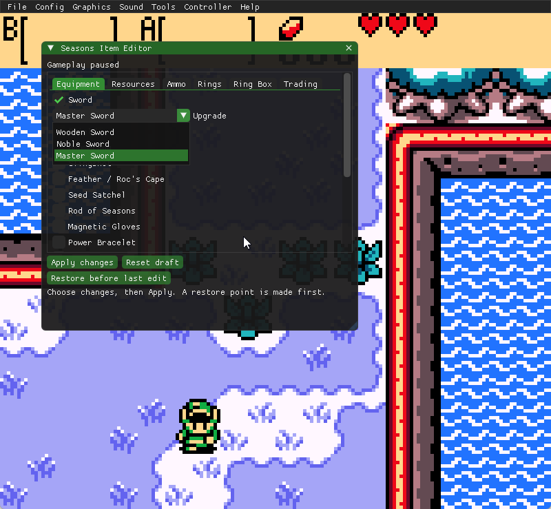
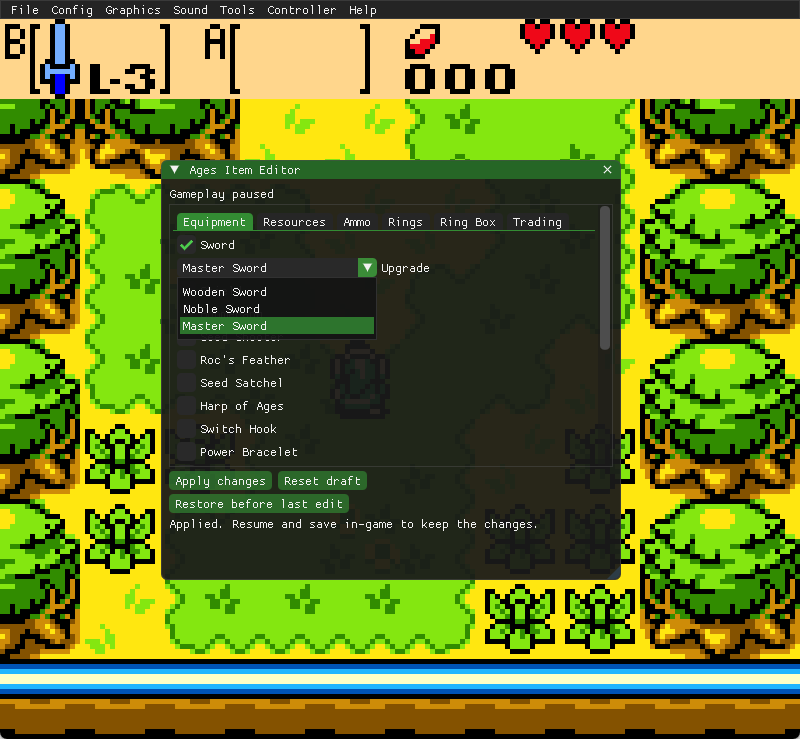
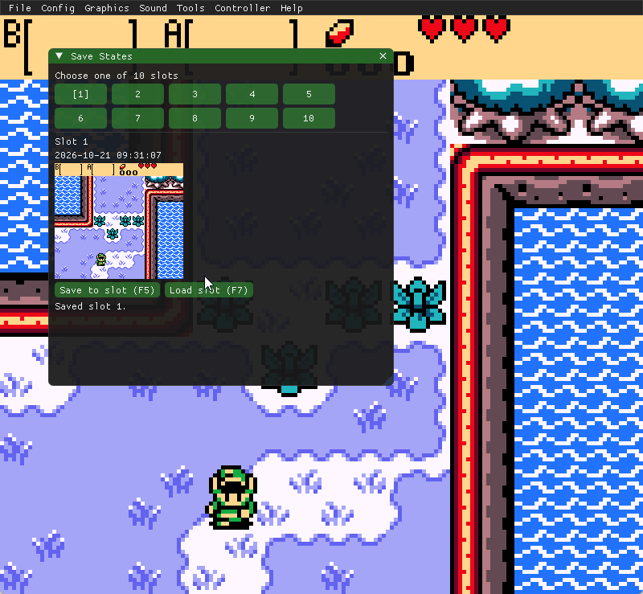
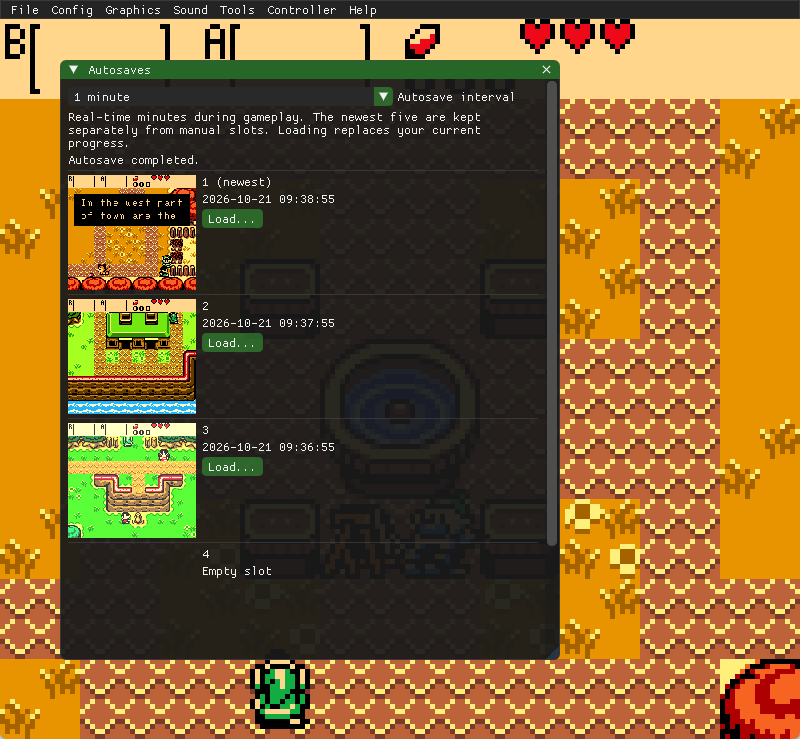
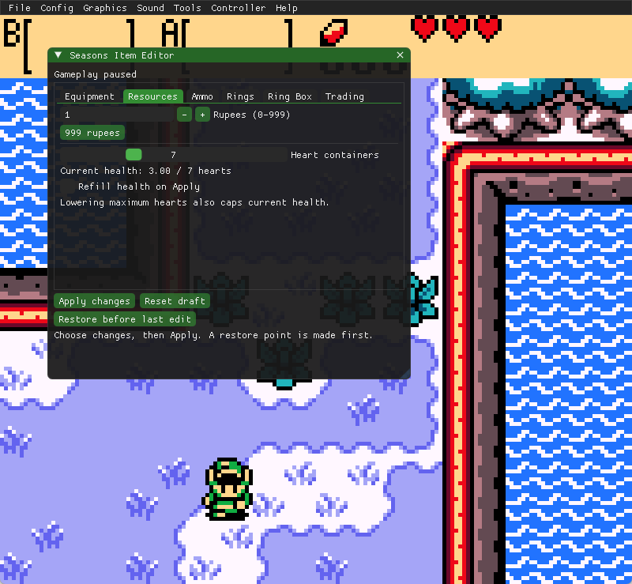
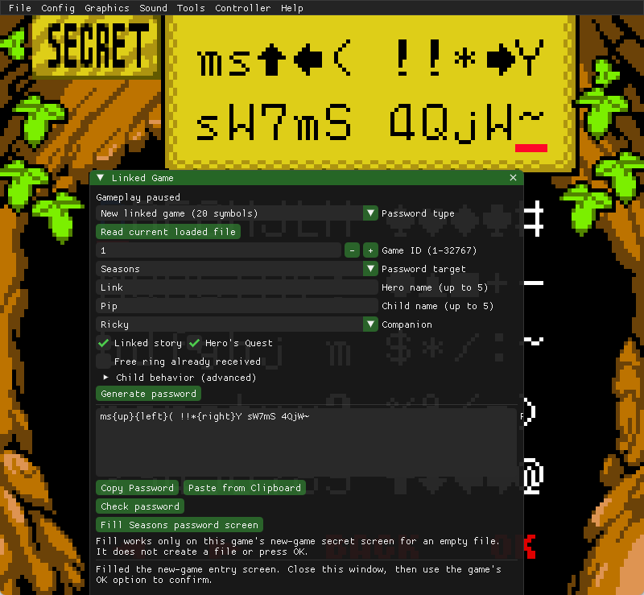
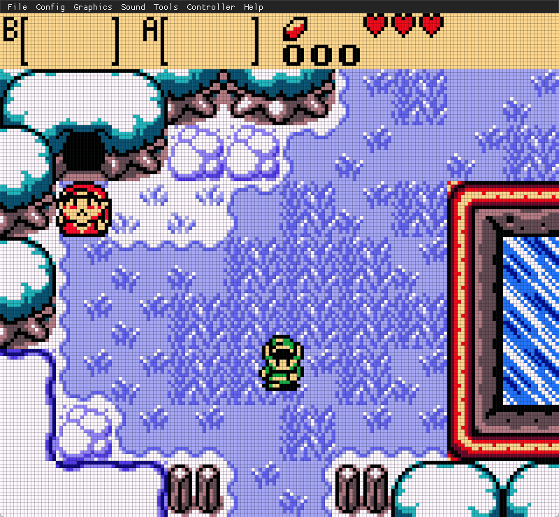
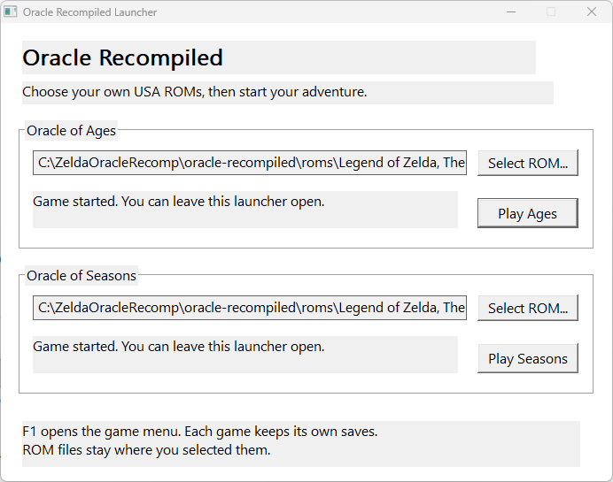

# Oracle Portable — Interpreter Preview

[Join our Discord](https://discord.gg/hsJHBQfmAS) — chat, get help, report bugs, and follow updates.

An enhanced, interpreter-based player for Oracle of Ages and Oracle of Seasons.
This version is not a static recompilation. The static recompilation remains
on the main branch.

<!-- BEGIN ORACLE FEATURE SHOWCASE -->
## Enhancements at a glance

**Press F1 to show or hide the in-game menu.** The menu starts hidden so you can play with an unobstructed game view.

### Editors for both adventures

| Oracle of Seasons | Oracle of Ages |
| --- | --- |
|  |  |
| Choose equipment and upgrades. Gameplay pauses while editing, with a restore point before applying changes. | A separate editor for Ages, including its own equipment and upgrades. |

### Save previews and rotating autosaves

| Ten manual save-state slots | Five rotating autosaves |
| --- | --- |
|  |  |
| Pick a numbered slot and see its screenshot and timestamp before loading. | Choose a gameplay interval and keep the newest five autosaves separately from manual slots. |

### Resources and ring collection

| Resources | Rings |
| --- | --- |
|  |  |
| Adjust rupees and heart containers, or refill health when applying edits. | Set individual rings to absent, unappraised or collected. |

### Linked-password tools and LCD filters

| Linked-password tools | LCD pixel filter |
| --- | --- |
|  |  |
| Generate and check supported passwords, copy or paste them, and fill the supported in-game entry screen. | Give the game an LCD-style pixel grid while keeping its original pixel artwork. |

*Password-tool limits: Ages ring-password filling remains unfinished; five-character NPC secrets are not implemented.*

### One launcher for both games

Select your own supported USA ROMs, then launch either game. ROM locations are remembered, and each game keeps its own saves. The portable interpreter package needs no player-side compilation.

Screenshots captured from the actual Windows portable interpreter build. Click an image to inspect it at full size. Game visuals belong to Nintendo / Capcom Flagship; project and third-party credits remain below.
<!-- END ORACLE FEATURE SHOWCASE -->

## Playing the portable package

Extract the entire portable ZIP into a writable folder.
Open oracle-launcher.exe, select your own supported USA ROMs, and click Play.
Players do not need MSYS2, a compiler, or a game-build step.
Press **F1** to show or hide the in-game menu.

Each game keeps its own saves beside its executable.
Keep the folder layout and bundled DLLs together.
No ROMs, generated game code, or personal saves are supplied.

## Building from source

Developers can build the runtime and launcher using MSYS2 MINGW64 with
GCC, CMake, Ninja, and SDL2 installed:

    cmake -S . -B build -G Ninja -DCMAKE_BUILD_TYPE=Release
    cmake --build build --parallel 2

No ROM is needed to compile this interpreter version.
The launcher is produced at build/bin/oracle-launcher.exe.

## Tested

Both games launched, reached gameplay, and retained saves after reopening.
The interpreter experiment also passed user-reported autosave and editor checks.
Both games launched from a freshly extracted portable ZIP.
The user estimated the interpreter build took under three minutes.
A full playthrough and testing on a separate clean Windows PC remain outstanding.

## Credits and licenses

Based on sp00nznet/oracle-recompiled and the gb-recompiled runtime by
arcanite24, contributors, and sp00nznet.
Uses Dear ImGui and SDL2.
The linked-secret adaptation derives from ZoraSharp by Amy Nagle.

Retain LICENSE, launcher/LICENSE, third-party notices, and LGPL/GPL texts.
The portable test package includes application source and rebuild instructions.
Public binary distribution review remains outstanding.

The older generation and setup scripts retained on this branch are from
the static recompilation workflow and are not needed for this interpreter build.
